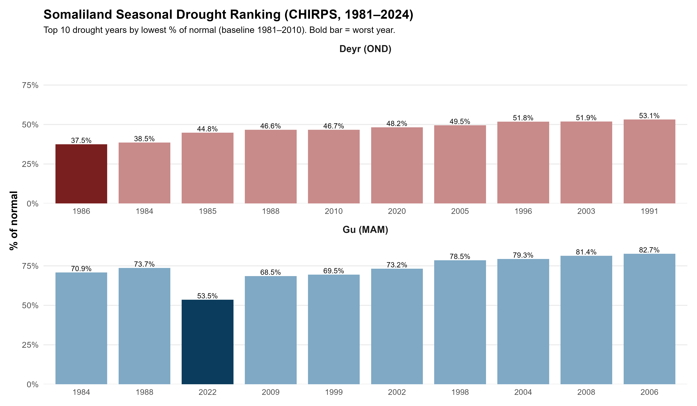
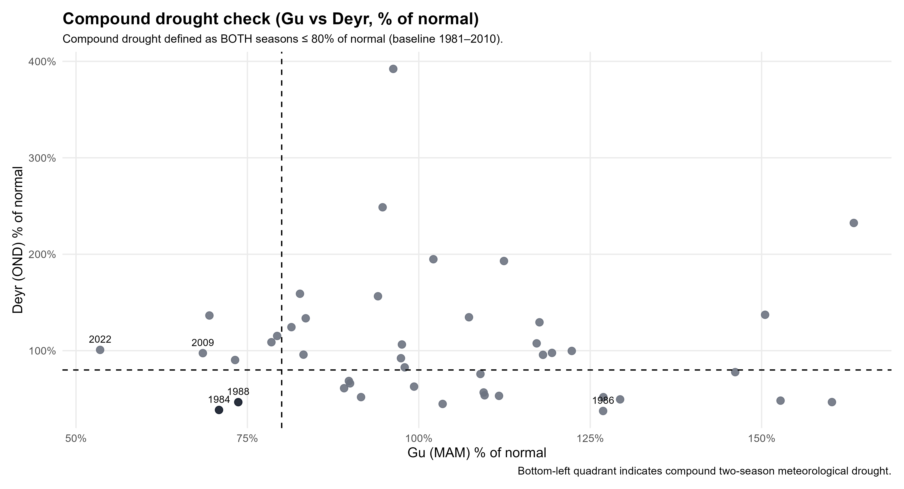

# Somaliland Meteorological Drought Ranking (1981–2024)

**Seasonal rainfall deficits, historical drought rankings, and compound drought occurrence using CHIRPS precipitation**

[](https://www.chc.ucsb.edu/data/chirps)   [](LICENSE)

## Overview

This project evaluates historical **meteorological drought** in Somaliland using satellite-derived precipitation from the Climate Hazards Center InfraRed Precipitation with Station data (CHIRPS). It compares seasonal rainfall totals with a 1981–2010 reference climatology, ranks rainfall-deficit years, and identifies years in which both major rainfall seasons experienced below-normal precipitation.

The analysis covers **1981–2024**, with the following operational season definitions used consistently throughout this repository:

| Season | Months used in this analysis | Abbreviation |
|---|---|---|
| Gu | March–May | MAM |
| Deyr | October–December | OND |

> **Scope:** This is a rainfall-based assessment of meteorological drought. The rankings do not represent agricultural, hydrological, or socioeconomic drought impacts.

## Research objectives

1. Quantify seasonal rainfall anomalies and percentages of normal rainfall for Gu and Deyr.
2. Rank the most rainfall-deficient seasons during 1981–2024.
3. Identify years with simultaneous rainfall deficits in both seasons.
4. Map selected historical seasonal rainfall anomalies and publish reproducible tables and figures.

## Data and study settings

| Component | Specification |
|---|---|
| Study area | Somaliland; Admin-0 boundary supplied as a Google Earth Engine asset |
| Precipitation | CHIRPS, accessed through Google Earth Engine |
| Analysis period | 1981–2024 |
| Baseline climatology | 1981–2010 |
| Gu | March–May (MAM) |
| Deyr | October–December (OND) |
| Analytical environment | Google Earth Engine JavaScript and R |
| Outputs | CSV tables, GeoTIFF anomaly rasters, PNG figures |

## Methods

### Seasonal rainfall diagnostics

For each season and year, seasonal rainfall is calculated from CHIRPS precipitation and compared with the corresponding 1981–2010 seasonal mean.

**Rainfall anomaly (mm)**

$$
A_{y,s} = P_{y,s} - \overline{P}_{1981-2010,s}
$$

**Percentage of normal rainfall (%)**

$$
N_{y,s} = 100 \times \frac{P_{y,s}}{\overline{P}_{1981-2010,s}}
$$

where $P_{y,s}$ is the seasonal rainfall total in year $y$ and season $s$, and $\overline{P}_{1981-2010,s}$ is the corresponding baseline mean. Lower percentages indicate greater rainfall deficits relative to that season's climatology.

### Drought rankings

Gu and Deyr seasons are ranked separately based on rainfall deficits relative to the baseline climatology. This allows historical rainfall failures to be compared within the same seasonal definition.

### Compound seasonal drought

A year is classified as having **compound seasonal rainfall deficit** when both seasons meet the predefined threshold:

$$
N_{y,Gu} \le 80\% \quad \text{and} \quad N_{y,Deyr} \le 80\%
$$

This is an operational threshold adopted for this analysis, not a claim that simultaneous deficits necessarily produced equivalent impacts across livelihoods or locations.

## Key findings

| Metric | Result |
|---|---|
| Most rainfall-deficient Gu (MAM) season | **2022** — **53.5%** of normal; approximately **−43.7 mm** anomaly |
| Most rainfall-deficient Deyr (OND) season | **1986** — **37.5%** of normal; approximately **−28.5 mm** anomaly |
| Notable compound-deficit years | **1984** and **1988** among the strongest identified |

Compound deficits meeting the 80%-of-normal threshold in both seasons were uncommon in the reported analysis. These findings describe **seasonal rainfall departures**; they do not rank overall drought damages or human consequences.

### Figures and visual outputs

The following figures are available in the repository; each link opens the actual PNG file on GitHub.

| Research output | Figure |
|---|---|
| Gu and Deyr: top-ten rainfall-deficit seasons | [View combined rankings](Somaliland-Meteorological-Drought-Ranking/03_Outputs/Figures/Top10_Gu_Deyr_Combined_Polished.png) |
| Simultaneous Gu–Deyr seasonal rainfall deficits | [View compound drought scatterplot](Somaliland-Meteorological-Drought-Ranking/03_Outputs/Figures/Compound_Drought_Scatter_Polished.png) |
| Spatial patterns of selected rainfall anomalies | [View clean 2 × 2 anomaly map](Somaliland-Meteorological-Drought-Ranking/03_Outputs/Figures/MAP_PANEL_2x2_Somaliland_Anomalies_Clean.png) |
| Alternative CHIRPS map panel | [View CHIRPS anomaly maps](Somaliland-Meteorological-Drought-Ranking/03_Outputs/Figures/MAP_PANEL_2x2_Somaliland_CHIRPS_Anomalies.png) |
| Separate Gu rankings | [View Gu top-ten figure](Somaliland-Meteorological-Drought-Ranking/03_Outputs/Figures/Gu_Top10.png) |
| Separate Deyr rankings | [View Deyr top-ten figure](Somaliland-Meteorological-Drought-Ranking/03_Outputs/Figures/Deyr_Top10.png) |



*Figure 1. Historical Gu and Deyr seasonal rainfall-deficit rankings.*



*Figure 2. Joint Gu–Deyr rainfall conditions and the compound-deficit threshold.*

## Repository structure

The following paths reflect the files and folders verified on the `main` branch in October 2026:

```text
.
├── README.md
└── Somaliland-Meteorological-Drought-Ranking/
    ├── 02_R_Script/
    │   └── Somaliland-Meteorological-Drought-Ranking.R
    ├── Data/
    │   ├── CSV/
    │   │   ├── Somaliland_Gu_MAM_CHIRPS_Table_1981_2024.csv
    │   │   ├── Somaliland_Gu_MAM_Top10_DroughtYears_1981_2024.csv
    │   │   ├── Somaliland_Deyr_OND_CHIRPS_Table_1981_2024.csv
    │   │   └── Somaliland_Deyr_OND_Top10_DroughtYears_1981_2024.csv
    │   └── GeoTiff/
    │       ├── Somaliland_Gu_MAM_Anomaly_mm_2022_vs_1981_2010.tif
    │       ├── Somaliland_Gu_MAM_Anomaly_mm_2009_vs_1981_2010.tif
    │       ├── Somaliland_Deyr_OND_Anomaly_mm_1986_vs_1981_2010.tif
    │       └── Somaliland_Deyr_OND_Anomaly_mm_2020_vs_1981_2010.tif
    ├── 03_Outputs/
    │   ├── Figures/
    │   │   ├── Top10_Gu_Deyr_Combined_Polished.png
    │   │   ├── Compound_Drought_Scatter_Polished.png
    │   │   ├── Gu_Top10.png
    │   │   ├── Deyr_Top10.png
    │   │   ├── MAP_PANEL_2x2_Somaliland_Anomalies_Clean.png
    │   │   └── MAP_PANEL_2x2_Somaliland_CHIRPS_Anomalies.png
    │   └── tables/
    │       ├── Gu_MAM_Top5.csv
    │       └── Deyr_OND_Top5.csv
    └── LICENSE (MIT).md
```

## Reproducing the analysis

### Requirements

- Access to [Google Earth Engine](https://earthengine.google.com/) for the CHIRPS extraction stage and permission to use an appropriate Somaliland study-area boundary.
- R and the packages called in the [R analysis script](Somaliland-Meteorological-Drought-Ranking/02_R_Script/Somaliland-Meteorological-Drought-Ranking.R).
- Input CSV tables from the [Data/CSV directory](Somaliland-Meteorological-Drought-Ranking/Data/CSV).

### 1. Obtain or reproduce CHIRPS seasonal data

The repository includes exported [seasonal rainfall tables](Somaliland-Meteorological-Drought-Ranking/Data/CSV) and [rainfall-anomaly GeoTIFFs](Somaliland-Meteorological-Drought-Ranking/Data/GeoTiff). These are sufficient to inspect the published outputs. The current public tree does **not** contain a standalone GEE JavaScript extraction script; reproducing the upstream data extraction requires an independently configured Earth Engine workflow and study-area asset.

### 2. Inspect and run the R analysis

Review the [R analysis script](Somaliland-Meteorological-Drought-Ranking/02_R_Script/Somaliland-Meteorological-Drought-Ranking.R) and update its working-directory and input-file paths as needed. Use the published CSV data to recreate calculations and graphical products supported by that script; a clean-environment, end-to-end reproduction has not been independently validated here.

### 3. Compare outputs with published figures

Inspect the [figures folder](Somaliland-Meteorological-Drought-Ranking/03_Outputs/Figures) and [summary tables](Somaliland-Meteorological-Drought-Ranking/03_Outputs/tables). Verify the 1981–2010 baseline, seasonal windows (Gu=MAM and Deyr=OND), ranking definitions, and the compound seasonal deficit threshold before interpreting or extending the results.

## Interpretation and limitations

- **Meteorological scope:** Precipitation anomalies are not interchangeable with soil-moisture stress, streamflow shortages, crop losses, or livelihood impacts.
- **Satellite precipitation uncertainty:** CHIRPS estimates may contain location- and season-dependent biases; no independent station-based validation is reported here.
- **Baseline sensitivity:** Drought rankings and percentage-of-normal metrics depend on the 1981–2010 reference period.
- **Season definitions:** This project uses MAM and OND operational windows. Other studies may define Somaliland's rainy seasons differently, so comparisons should check month selection first.
- **Spatial aggregation:** Country-scale seasonal values may conceal substantial subregional variation.
- **Machine learning:** A simple forecasting baseline was tested separately for skills demonstration; its code and results are **not part of the documented reproducible workflow** in this repository.

## Research applications

The workflow provides a transparent starting point for studying historical rainfall extremes, seasonal co-occurrence of deficits, and spatial variations in precipitation anomalies. It can also support future extensions involving station validation, alternative drought indices, forecast evaluation, or links between meteorological conditions and documented impacts. Such extensions are **not** results of the present repository.

## How to cite

If using or adapting this repository, please cite the author and repository URL. A suggested software citation is:

> Ismail, A. H. (2026). *Somaliland Meteorological Drought Ranking (1981–2024): CHIRPS Gu and Deyr Seasonal Analysis* [Code and data]. GitHub. https://github.com/AhmedEid02/Somaliland-Meteorological-Drought-Ranking

No archived software DOI or tagged release is currently documented.

## Author and license

**Ahmed Hussein Ismail** — Climate and geospatial researcher, Somaliland  
[GitHub](https://github.com/AhmedEid02) · [Research portfolio](https://ahmedeid02.github.io/)

Released under the [MIT License](Somaliland-Meteorological-Drought-Ranking/LICENSE%20%28MIT%29.md).
